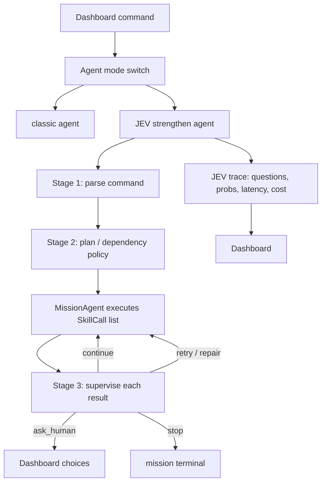

# JEV Strengthen Agent 设计 Guideline

> 本文为早期总体思路。后续职责和任务粒度以 [Mission README](README.md)、[Navigation README](../navigaiton-agent/README.md)、[Perception README](../perception-agent/README.md) 为准：正常成功不要求逐 skill 调用 JEV；复杂 Task 内部由领域 Agent 处理，Mission 只做任务级编排和跨任务判断。Cancel/安全停止不依赖 JEV。

目标：在现有 `robot_agent` 旁边设计一个并行的 **JEV strengthen agent**，作为
`Deterministic/Embedding/LLM parser + MissionAgent if/else supervision` 的对比项。
它不直接替代 skill layer，而是优化两件事：

1. **自然语言解析**：把自由文本解析成 typed intent / ordered steps / ambiguity choices。
2. **执行监督**：每个 step 结束后判断继续、停止、恢复、重试、问人，避免把复杂系统靠硬编码
   if/else 全部枚举。

JEV 的定位不是“会写长文本的 LLM”，而是 fast typed decision model：输入 unstructured
state + structured program state，输出提前定义好的 typed probabilities / score / choice。
参考：

- https://typesafe.ai/blog/introducing-system-one-models-and-jev
- https://www.tryjev.xyz/

---

## 1. 为什么需要 JEV Agent

当前 agent 的不稳定主要不是单个 skill 写错，而是复杂系统里有很多“该不该继续”的判断：

- `find red box, then set pose home`：如果没有 red box，后面的 `set_pose home` 是否还应该执行？
- `go back/turn`：localization BAD 但 wheel odom 正常时是否继续？
- perception 没有检测结果：任务是“看一下”还是“找到目标物”？前者可完成，后者需要人工确认。
- control mode/manual/auto、safety/watchdog、ROS node 状态、camera stale、GPU/Isaac 负载、parser ambiguity 等都可能影响执行，但影响程度不同。

这些判断不适合全部写成固定 if/else。更好的结构是：

```text
现有 code 负责约束边界和执行 skill
JEV 负责在约束边界内做 typed probabilistic decisions
Dashboard 负责显示每次决策的问题、概率、耗时、成本和最终分支
```

JEV Agent 的设计原则：

- 所有输出必须是 schema 内的 typed value，不能输出自由文本 tool call。
- 每次调用包含多个并行 questions，用 `choice / score / noul` 分解复杂判断。
- code 只读 probabilities，不相信单一 label；低置信度进入 ask_human。
- safety-critical rule 仍由硬逻辑保护，JEV 不能绕过 safety BAD、E-stop、未知 actuator 状态。
- JEV 只做“决策增强”，不直接发 ROS command。

---

## 2. 是否还需要 LLM / Embedding Parser

如果启用 `jev_mode`，**command 解析阶段原则上不再需要 embedding parser 或 llama fallback**。

建议的解析链：

```text
JEV mode:
  deterministic safety shortcut
    -> JEV command_parse_decision
    -> schema validation
    -> if low confidence / null / ambiguity: ask_human choices

classic mode:
  deterministic -> embedding -> llama.cpp fallback
```

仍保留 deterministic shortcut 的原因：

- `cancel / stop / status / emergency-like commands` 应该最快、最可预测。
- 明确固定按钮类命令不需要花 API 调用。
- 作为 JEV 不可用时的 fallback。

不建议在 JEV mode 里继续 embedding/LLM 的原因：

- 目标正是比较“JEV typed decision graph” vs “现有 parser cascade”。
- 多模型串联会让 latency/cost attribution 变乱。
- LLM/embedding 输出没有校准概率，不适合监督阶段统一处理。

可选策略：

- `jev_primary`: JEV 为主，JEV unavailable 才 fallback classic。
- `jev_shadow`: classic 实际执行，JEV 只旁路评分，dashboard 对比。
- `classic`: 当前系统。

---

## 3. 总体架构



JEV Agent 不应该重新实现 skills。它只输出：

- `MissionIntent` 或 `SequenceIntent`
- 每步 dependency/continuation policy
- 每步失败后的 supervision decision
- dashboard 可解释 trace

---

## 4. Input JSON 设计

### 4.1 顶层 request

```json
{
  "schema_version": "jev_robot_agent.v1",
  "run_id": "mission id or pre-mission id",
  "stage": "command_parse | plan_review | step_supervision | recovery_choice | final_assessment",
  "mode": "sim | real",
  "agent_mode": "classic | jev_primary | jev_shadow",
  "timestamp": "2026-09-30T00:00:00Z",
  "user_command": "find red box, then set pose home",
  "locale_hints": ["en", "ja", "zh"],
  "robot_state": {
    "robot_mode": "AUTO | MANUAL | UNKNOWN",
    "safety_status": "OK | WATCHDOG | MANUAL_STOP | ESTOP | UNKNOWN",
    "stationary": true,
    "active_skill": null,
    "health_overall": "OK | WARN | BAD | UNKNOWN",
    "components": {
      "localization": {
        "level": "BAD",
        "summary": "GICP_SCORE_MISSING",
        "details": {
          "localization_requires_recovery": false,
          "latest_wheel_odom_pose": [0.0, 0.0, 0.0],
          "gicp_score": null
        }
      },
      "local_planner": {"level": "OK", "summary": "active"},
      "perception": {"level": "OK", "summary": "camera fresh"},
      "arm": {"level": "OK", "summary": "gateway ready"}
    }
  },
  "available_skills": [
    {
      "name": "move_relative",
      "args_schema": {"direction": ["forward", "back", "left", "right"], "distance_m": "float"},
      "preconditions": ["AUTO", "safety_ok", "wheel_odom_or_map_pose"],
      "risk": "base_motion"
    },
    {
      "name": "look_direction",
      "args_schema": {"direction": ["left", "right", "front"], "band": ["middle", "upper", "ground"]},
      "preconditions": ["stationary", "camera_ready"],
      "risk": "perception_only"
    },
    {
      "name": "set_pose",
      "args_schema": {"name": ["home", "see_front", "see_left", "see_right", "wave"]},
      "preconditions": ["stationary", "arm_ready"],
      "risk": "arm_motion"
    }
  ],
  "current_plan": [],
  "completed_steps": [],
  "latest_step_result": null,
  "dashboard_context": {
    "user_can_answer": true,
    "allow_auto_retry": true,
    "show_debug": true
  }
}
```

### 4.2 Step result 输入

`step_supervision` 阶段需要把 skill result、健康状态、观察结果一起给 JEV：

```json
{
  "stage": "step_supervision",
  "user_command": "find red box, then set pose home",
  "current_plan": [
    {
      "step_id": "s1",
      "intent_role": "required_condition | observation | cleanup | independent_action",
      "skill": "detect_known_object",
      "payload": {"query": "red box"},
      "on_failure_policy_hint": "ask_or_stop"
    },
    {
      "step_id": "s2",
      "intent_role": "independent_cleanup_or_pose",
      "skill": "set_pose",
      "payload": {"name": "home"},
      "on_failure_policy_hint": "continue_if_safe"
    }
  ],
  "latest_step_result": {
    "step_id": "s1",
    "skill": "detect_known_object",
    "success": false,
    "code": "NEEDS_HUMAN",
    "message": "No confident match for red box.",
    "metrics": {
      "query": "red box",
      "observation_count": 9,
      "detections": [],
      "annotated_images": [],
      "captured_images": ["debug-output/perception/.../observation_000.jpg"]
    }
  },
  "robot_state": {
    "safety_status": "WATCHDOG",
    "robot_mode": "AUTO",
    "stationary": true,
    "health_overall": "BAD",
    "components": {
      "localization": {"level": "BAD", "summary": "GICP_SCORE_MISSING"},
      "arm": {"level": "OK", "summary": "ready"},
      "perception": {"level": "OK", "summary": "camera fresh"}
    }
  }
}
```

---

## 5. JEV Questions 设计

JEV 的核心不是问一个大问题，而是一次并行问多个小问题。每个问题都有 `id/type/instructions/criteria`。

类型约定：

- `choice`: 在有限选项中选一个，必须带 probabilities。
- `score`: 0-1 或 0-100 的连续评分，用于 confidence/risk/relevance。
- `noul`: nullable boolean，输出 `true / false / null`，适合“不确定也很重要”的判断。

### 5.1 Command Parse 阶段

输入：用户文本、可用技能、少量 robot state。

Questions：

```json
[
  {
    "id": "command_kind",
    "type": "choice",
    "instructions": "Classify the command into a supported high-level intent shape.",
    "choices": [
      "single_step",
      "ordered_sequence",
      "parallel_or_independent_goals",
      "status_or_cancel",
      "ambiguous_or_unsupported"
    ]
  },
  {
    "id": "sequence_boundary_count",
    "type": "score",
    "instructions": "Estimate number of ordered action boundaries minus one, normalized 0=no boundary, 1=multiple boundaries."
  },
  {
    "id": "requires_human_clarification",
    "type": "noul",
    "instructions": "Is the command too ambiguous to safely map to supported skills?"
  },
  {
    "id": "parse_confidence",
    "type": "score",
    "instructions": "Confidence that the proposed structured plan preserves the user's intended order and meanings."
  },
  {
    "id": "primary_task_type",
    "type": "choice",
    "instructions": "Choose primary task type for the first executable step.",
    "choices": [
      "move_relative",
      "rotate_relative",
      "look_direction",
      "search_object_here",
      "set_pose",
      "touch_object",
      "press_object",
      "grasp_object",
      "navigate_to_place",
      "robot_status",
      "cancel"
    ]
  }
]
```

输出由 adapter 组装成：

```json
{
  "intent": {
    "task_type": "sequence",
    "constraints": {
      "steps": [
        {
          "task_type": "search_object_here",
          "object_query": "red box",
          "intent_role": "required_condition",
          "on_failure_policy_hint": "ask_or_stop"
        },
        {
          "task_type": "set_pose",
          "target": "home",
          "intent_role": "independent_cleanup_or_pose",
          "on_failure_policy_hint": "continue_if_safe"
        }
      ]
    }
  },
  "parse_decision": {
    "accepted": true,
    "confidence": 0.91,
    "needs_human": false
  }
}
```

### 5.2 Plan Review 阶段

输入：parser 输出、SkillCall plan、当前 health。

Questions：

```json
[
  {
    "id": "plan_is_executable_now",
    "type": "noul",
    "instructions": "Given robot state and skill preconditions, can the plan start now?"
  },
  {
    "id": "blocked_by_component",
    "type": "choice",
    "choices": ["none", "safety", "control_mode", "localization", "local_planner", "perception", "arm", "ros_node", "unknown"]
  },
  {
    "id": "safe_to_ignore_localization_for_this_plan",
    "type": "noul",
    "instructions": "Return true only if every planned base motion is relative/direct and has wheel odom feedback, or no base motion exists."
  },
  {
    "id": "plan_risk_score",
    "type": "score",
    "instructions": "0=safe observation only, 1=high risk physical action."
  },
  {
    "id": "start_action",
    "type": "choice",
    "choices": ["start", "ask_human", "wait", "run_recovery", "reject"]
  }
]
```

### 5.3 Step Supervision 阶段

这是最重要的阶段，用来回答“前一步失败，下一步是否继续”。

Questions：

```json
[
  {
    "id": "step_failure_category",
    "type": "choice",
    "choices": [
      "none_success",
      "target_not_found",
      "ambiguous_detection",
      "camera_or_perception_fault",
      "control_mode_block",
      "safety_block",
      "localization_unrelated",
      "localization_related",
      "local_planner_fault",
      "arm_fault",
      "timeout_or_load",
      "logic_or_parse_error",
      "unknown"
    ]
  },
  {
    "id": "failure_blocks_user_goal",
    "type": "noul",
    "instructions": "Does this failed step block the user's main goal, not just an optional observation or cleanup?"
  },
  {
    "id": "next_step_still_meaningful",
    "type": "noul",
    "instructions": "Can the next step still be useful and safe even though the previous step failed?"
  },
  {
    "id": "need_human_choice",
    "type": "noul",
    "instructions": "Should a human choose between continue/stop/retry because intent is value-dependent?"
  },
  {
    "id": "auto_retry_score",
    "type": "score",
    "instructions": "Likelihood that an immediate retry or alternate view will fix this failure."
  },
  {
    "id": "supervision_action",
    "type": "choice",
    "choices": [
      "continue_next_step",
      "stop_failed",
      "ask_human_continue_or_stop",
      "retry_same_step",
      "retry_with_alternate_view",
      "run_recovery_then_retry",
      "mark_done_with_observation",
      "escalate_logic_design_issue"
    ]
  }
]
```

Example for `find red box, then set pose home` when red box is absent:

```json
{
  "step_failure_category": {"choice": "target_not_found", "p": 0.89},
  "failure_blocks_user_goal": {"value": true, "p_true": 0.72, "p_false": 0.20, "p_null": 0.08},
  "next_step_still_meaningful": {"value": true, "p_true": 0.66, "p_false": 0.19, "p_null": 0.15},
  "need_human_choice": {"value": true, "p_true": 0.81, "p_false": 0.12, "p_null": 0.07},
  "auto_retry_score": 0.31,
  "supervision_action": {
    "choice": "ask_human_continue_or_stop",
    "p": 0.78
  },
  "human_choices": [
    {
      "id": "continue_home",
      "label": "Red box was not found, but move arm to home anyway",
      "command_patch": {"continue_from_step": "set_pose_home"}
    },
    {
      "id": "retry_search",
      "label": "Search again from another view",
      "command_patch": {"insert_steps": ["look_direction/front", "capture", "detect red box"]}
    },
    {
      "id": "stop",
      "label": "Stop because the target was not found",
      "command_patch": {"terminal_status": "NEEDS_HUMAN_STOPPED"}
    }
  ]
}
```

这个例子不应该固定成“永远继续”或“永远停止”。原因：

- 用户可能只是想“找一下，然后无论如何回 home”。
- 用户也可能想“找到 red box 后再 home”，找不到就应该停。
- `set_pose home` 本身是安全 cleanup，但继续执行可能掩盖“目标没找到”的主任务失败。

所以默认策略应是：

```text
前一步失败 + 下一步安全但语义是否继续不确定
=> ask_human_continue_or_stop
```

### 5.4 Recovery Choice 阶段

Questions：

```json
[
  {
    "id": "recovery_applicable",
    "type": "noul",
    "instructions": "Is there a known recovery that directly addresses the blocking condition?"
  },
  {
    "id": "recovery_target",
    "type": "choice",
    "choices": ["none", "localization", "local_planner", "camera", "arm_gateway", "ros_node_restart", "wait_for_load", "human_manual_mode"]
  },
  {
    "id": "recovery_risk_score",
    "type": "score",
    "instructions": "0=non-invasive wait/retry, 1=high-risk reset or physical motion."
  },
  {
    "id": "recovery_action",
    "type": "choice",
    "choices": ["no_recovery", "wait", "retry", "spin_localization", "restart_node", "ask_human", "suggest_logic_change"]
  }
]
```

### 5.5 Final Assessment 阶段

Questions：

```json
[
  {
    "id": "mission_goal_satisfied",
    "type": "noul",
    "instructions": "Did the mission satisfy the user's substantive request?"
  },
  {
    "id": "completion_quality_score",
    "type": "score",
    "instructions": "0=failed, 1=fully satisfied."
  },
  {
    "id": "needs_design_followup",
    "type": "noul",
    "instructions": "Did this run expose a logic/design gap that should become a coding task?"
  },
  {
    "id": "followup_category",
    "type": "choice",
    "choices": ["none", "parser", "skill", "health_policy", "dashboard_visibility", "recovery_agent", "system_load", "ros_graph"]
  }
]
```

---

## 6. Score / Null / Choice 阈值设计

### 6.1 通用阈值

```yaml
confidence_policy:
  accept_choice_min_p: 0.72
  ask_human_choice_band: [0.45, 0.72]
  reject_choice_max_p: 0.45
  noul_null_min_p: 0.30
  score_high: 0.75
  score_medium: 0.45
```

### 6.2 `noul` 使用规则

`noul` 的价值是明确表达“不知道”。例如：

- `failure_blocks_user_goal = null`：语义不确定，问人。
- `plan_is_executable_now = null`：状态信息不足，先做 cheap health query 或问人。
- `recovery_applicable = null`：不要自动 recovery，避免瞎重启。

代码策略：

```text
noul true with p_true >= 0.72  -> treat true
noul false with p_false >= 0.72 -> treat false
p_null >= 0.30                 -> ask_human or gather more state
else                           -> use conservative default
```

### 6.3 多问题组合

不要只看 `supervision_action`。组合规则：

```text
if safety_bad:
  stop / ask_human, JEV cannot override

if supervision_action=continue_next_step
  and next_step_still_meaningful=true
  and plan_risk_score < 0.45:
    continue

if failure_blocks_user_goal=true
  and next_step_still_meaningful=true
  and need_human_choice=true:
    ask_human_continue_or_stop

if auto_retry_score > 0.75
  and retry_count <= limit
  and risk low:
    retry / alternate view
```

---

## 7. API 调用 Trace / 时间 / Cost

每次 mission 必须记录：

- 每个 JEV call 的开始/结束时间。
- 输入 JSON bytes / estimated tokens。
- questions 数量。
- response size。
- provider/model。
- cost estimate。
- 每个 question 的输出概率。
- code 最终采用哪个 decision。

Trace schema：

```json
{
  "jev_trace": {
    "mission_id": "abc123",
    "agent_mode": "jev_primary",
    "total": {
      "calls": 3,
      "latency_ms": 412,
      "input_tokens_est": 6220,
      "output_cost_usd": 0.0,
      "input_cost_usd": 0.000261,
      "estimated_total_cost_usd": 0.000261
    },
    "calls": [
      {
        "call_id": "jev_001",
        "stage": "command_parse",
        "model": "typesafe/jev-1.13",
        "provider": "typesafe_or_openrouter",
        "question_count": 8,
        "started_at": "2026-09-30T00:00:00.000Z",
        "ended_at": "2026-09-30T00:00:00.118Z",
        "latency_ms": 118,
        "input_tokens_est": 2100,
        "input_cost_usd": 0.000088,
        "questions": [
          {
            "id": "command_kind",
            "type": "choice",
            "result": "ordered_sequence",
            "probabilities": {
              "ordered_sequence": 0.93,
              "single_step": 0.05,
              "ambiguous_or_unsupported": 0.02
            }
          }
        ],
        "adopted_decision": "parse_sequence",
        "fallback_used": false
      }
    ]
  }
}
```

Cost estimate：

```text
input_cost_usd = input_tokens_est / 1_000_000 * price_per_million_input_tokens
output_cost_usd = 0 for Jev if provider pricing keeps output free
```

参考页中示例价格是 `$0.042 / M input`，但实现时必须把价格配置化：

```yaml
jev:
  provider: openrouter
  model: typesafe/jev-1.13
  price_per_million_input_tokens_usd: 0.042
  output_cost_policy: free
```

Dashboard 显示：

```text
JEV: 3 calls · 412 ms · 6.2k input tok · $0.00026
command_parse 118 ms
plan_review 74 ms
step_supervision 220 ms
```

---

## 8. Dashboard Mode Toggle

新增 mode button：

```text
Agent Mode:
[ Classic ] [ JEV Primary ] [ JEV Shadow ]
```

行为：

- `Classic`: 当前 agent。
- `JEV Primary`: JEV 决定 parse / supervision，实际执行仍走 SkillClient。
- `JEV Shadow`: classic 决定执行；JEV 接收同样 state 只输出建议，不影响执行。Dashboard 同时显示：
  - classic decision
  - JEV decision
  - disagreement
  - latency/cost

需要新增 ROS/API 状态：

```json
{
  "agent_mode": "classic | jev_primary | jev_shadow",
  "jev_available": true,
  "last_jev_trace": {},
  "mode_changed_by": "dashboard | config | cli"
}
```

Dashboard 需要显示：

- Parser route：classic route vs JEV route。
- Supervision decision cards。
- Human choices generated by JEV。
- JEV timing/cost panel。
- Shadow disagreement badge：

```text
Classic stopped at detect red box.
JEV recommends ask_human_continue_or_stop.
Confidence 0.78.
```

---

## 9. 实现分阶段计划

### Phase 0: Shadow-only 数据结构

- 新增 `JevDecisionTrace` schema。
- Dashboard 显示 JEV trace panel。
- 不调用外部 API，用 fake adapter 返回固定结果。
- 目标：确认 UI / log / mission_state 结构稳定。

### Phase 1: Command Parse Shadow

- JEV 只做 command parse。
- classic 仍实际执行。
- 对比：
  - parse success rate
  - sequence boundary accuracy
  - ambiguity handling
  - latency/cost

### Phase 2: JEV Primary Parse

- `jev_primary` 下 command parse 不再走 embedding/LLM。
- deterministic 只保留 cancel/status/safety shortcuts。
- parse confidence 低时 ask_human。

### Phase 3: Step Supervision Shadow

- 每个 skill result 后调用 JEV `step_supervision`。
- classic 仍按现有逻辑继续/停止。
- Dashboard 显示 disagreement。

### Phase 4: JEV Primary Supervision

- JEV 决定 continue / stop / ask_human / retry。
- hard safety rule 仍在 code 中最高优先级。
- recovery agent 尚未完成时，`run_recovery_then_retry` 先转成 ask_human 或 stop。

### Phase 5: Recovery Agent Integration

- 将 localization/camera/arm/ROS node recovery 做成可执行 skill。
- JEV 只选择 recovery target/action，不直接执行 shell/ROS restart。

---

## 10. 当前案例策略

### 10.1 `find red box, then set pose home`

建议 plan：

```text
await_robot_stationary
search red box / detect_known_object
JEV step_supervision
  if found: continue set_pose home
  if not found:
    ask_human:
      1. Continue to home anyway
      2. Retry search from another view
      3. Stop because target not found
set_pose home
```

不要默认直接卡死；也不要默认跳过失败继续。原因是语义不确定。

### 10.2 `左を見て`

这是 observation command，不是 target search。即使没有检测目标，只要：

- camera pose command 成功
- capture_observation 成功
- image artifact 已保存

就可以 DONE。Dashboard 显示 Captured observations album。

### 10.3 `前進少し`

这是 relative/direct base motion。JEV supervision 应判断：

- localization BAD 是否与任务相关：通常不相关，若 wheel odom fresh。
- control mode 是否 AUTO：相关。
- safety 是否 OK/WATCHDOG：相关。
- wheel odom 是否 fresh：相关。
- cmd_vel_raw 是否有 subscriber：相关。

如果 wheel odom fresh 且 safety OK，localization BAD 不应阻止。

### 10.4 `rotate_relative`

同 `前進少し`。如果 result 是 `CANCELLED`，JEV 应检查：

- 是否用户 cancel？
- 是否 health watchdog cancel？
- health BAD component 是否与 rotate 相关？
- 是否 safety changed？
- 是否 direct motion feedback missing？

如果只是 localization BAD watchdog cancel，应输出：

```json
{
  "step_failure_category": "localization_unrelated",
  "supervision_action": "escalate_logic_design_issue",
  "suggested_fix": "watchdog should not cancel relative motion for localization-only BAD"
}
```

---

## 11. 非目标

JEV Agent 不负责：

- 直接控制 ROS topic。
- 生成任意 Python/JS 代码。
- 绕过 safety layer。
- 替代 recovery skill 的具体实现。
- 判断物理世界安全边界，比如人是否在机器人旁边；这仍需要 sensor/safety system。

---

## 12. Open Questions

1. JEV API 直接用 TypeSafe endpoint，还是通过 OpenRouter provider？
2. 是否要把 `jev_shadow` 默认打开，用一段时间收集 disagreement log？
3. Dashboard 的 ask_human choices 是否允许“一键继续到第 N 步”？
4. JEV trace 是否写入 mission log 文件，还是只发 `/agent/mission_state`？
5. JEV unavailable 时，`jev_primary` 应 fallback classic，还是直接显示 service unavailable？

---

## 13. Live API 接入和 Key 管理

不要把 JEV API key 写入 git、markdown、launch file 或 dashboard log。启动 terminal 里设置环境变量即可：

```bash
export JEV_API_KEY="<your key>"
export JEV_API_URL="https://api.typesafe.ai/v1/systemone"
export JEV_MODEL="jev-latest"
export JEV_TIMEOUT_SEC=3.0
```

如果 `JEV_API_KEY` 未设置，dashboard 右上角会显示 `local`，JEV mode 仍可运行，但只是本地
typed-decision shim，适合 UI 和控制流测试，不代表真实 JEV 能力。

如果 key 正确且 endpoint 可访问，dashboard 右上角应显示 `live`。JEV trace 中每个 call 的
latency 会接近真实网络/API 时间，cost 会根据 API 返回的 `usage.input_tokens` 或本地估算展示。

Provider 选择：

- TypeSafe direct endpoint：`JEV_API_URL=https://api.typesafe.ai/v1/systemone`，
  `JEV_MODEL=jev-latest`。
- 如果使用 OpenRouter/tryjev provider，需要把 `JEV_API_URL` 和 `JEV_MODEL` 改成该 provider
  要求的值，例如模型名可能是 `typesafe/jev-1.13`。不要只替换 key。

---

## 14. 如何判断 JEV 是否真的变好

先不要直接只看 `jev_primary` 成败。建议三阶段：

1. `classic`：作为 baseline，运行固定命令集并记录 mission log。
2. `jev_shadow`：classic 仍负责实际执行，JEV 只做旁路判断；重点看 disagreement。
3. `jev_primary`：只有 shadow 中没有明显危险建议后，再让 JEV 影响解析和 step supervision。

### 14.1 Dashboard 上的快速判断

- `local` vs `live`：显示 `local` 说明没有使用真实 API；显示 `live` 才是 live JEV。
- call latency：local 通常约 `0.0-1 ms`；live 通常会是几十到数百 ms。
- cost：live 应有每次 call 和 mission total cost；local 只是估算。
- trace question：检查 `command_parse / plan_review / step_supervision` 的 question result 是否和人类判断一致。
- `fallback_used=true` 或 `jev_api_error`：说明该次 API 调用失败，不能用来评价 JEV 本身。

### 14.2 建议记录的指标

- `parse_correct_rate`：intent 类型、slot、ordered steps 是否正确。
- `sequence_policy_correct_rate`：`then/and/然后/それから` 多步骤中，前一步失败后是否做出合理继续/停止/问人。
- `task_completion_rate`：DONE 或合理 NEEDS_HUMAN 的比例。
- `false_stop_rate`：本来可以继续却停止，例如 localization BAD 阻止 `go back/turn`。
- `unsafe_continue_count`：不应该继续却继续，必须保持 0。
- `unnecessary_human_prompt_rate`：无需问人却打断用户。
- `recovery_help_rate`：JEV 建议 retry/recovery 后最终成功的比例。
- `latency_ms_per_mission`：总耗时和每个 JEV call 耗时。
- `cost_usd_per_mission`：每个任务的 API 成本。

### 14.3 最小测试集

命令解析：

```text
go back 1 m, then set pose home
find red box, then set pose home
左を見て
前進少し
turn right 90 degrees
go shelf 06
```

状态干扰：

```text
localization BAD + go back / turn
manual mode + perception command while robot is stationary
manual mode + base motion
no target detected + then set pose home
camera image stale / missing
rotate_relative CANCELLED
```

每条命令至少重复 5 次。对于不稳定问题，单次成功不能证明改善；要看失败率是否下降。

### 14.4 判定标准

JEV 比 classic 更好，需要同时满足：

- parse/sequence 正确率更高，或低置信度时能更早 `ask_human`。
- `false_stop_rate` 下降，特别是 relative move/turn 不再被无关 localization 阻止。
- perception 在 robot stationary 时不再被 auto/manual mode 错误阻止。
- `unsafe_continue_count = 0`。
- 增加的 latency 和 cost 在可接受范围内。
- shadow disagreement 中，被人工标注为 `JEV better` 的数量明显多于 `JEV worse`。

---

## 15. 公开实践补充：如何把 JEV 设计得更可靠

2026-10-04 调研到的公开 JEV/System One 使用方式基本一致：

- 请求形状是 `state + questions`。`state` 可以是文本或 JSON object；`questions` 是多个具名 typed questions。
- question 类型只有三类：`choice`、`score`、`noul`。
- `choice` 适合有限分支，例如 routing、下一步 action、failure category。
- `score` 适合连续或有序判断，例如 parse confidence、risk、retry usefulness。
- `noul` 适合 yes/no/unknown 判断，例如 “是否遗漏了用户子目标”。它的价值是允许 `null/unknown`，不要强行二分。
- 一次请求可以包含多个独立问题，共享同一个 state；问题越窄越容易被校准和调试。
- 业务阈值必须留在 code 里，不要让模型自己决定安全边界。
- 最可靠的 pattern 不是让 JEV 生成自由 JSON，而是由 code 生成 typed candidates，再让 JEV 在候选项里选择、评分、发现缺口。

参考资料：

- https://docs.system-one.dev/en/docs/api
- https://jevhub.org/docs/
- https://jev-agent.org/api
- https://systemonemodels.org/glossary/question/
- https://www.jevtypesafe.org/docs/jev-sdk/

这些原则对应到机器人系统时，可以总结为：

```text
code 负责枚举合法技能、候选计划、安全 gate、schema validation
JEV 负责判断自然语言和运行状态更像哪个 typed branch
Dashboard 负责显示每个 typed branch 的概率、阈值、耗时、成本、最终采用原因
```

不要把 JEV 当成“新的 LLM planner”。它更像一个低延迟的 typed decision judge。复杂任务应该拆成多轮、窄问题、可验证的候选。

---

## 16. 更完整的自然语言解析设计

当前目标不是把所有 wording 都写进 deterministic parser，而是让 deterministic/parser cascade 提供候选，JEV 负责验证和选择。

### 16.1 Parse Pipeline

推荐结构：

```text
user_text
  -> text_normalizer
       - language hints: en / ja / zh
       - typo hints: littlt -> little, bak -> back
       - sequence connectors: then, and, after, 然后, 然後, それから, そして
  -> candidate_generator
       - deterministic full parse candidate
       - segmented deterministic parse candidates
       - embedding top-k skill candidates
       - safe default candidates: ask_human, not_a_robot_command
  -> JEV command_parse_decision
       - validate deterministic result when it exists
       - choose best candidate when deterministic failed
       - detect missing subgoals
       - decide ask_human if confidence/risk threshold is not met
  -> schema validation
  -> MissionIntent / SequenceIntent
```

重点：JEV 不应该直接“自由生成一段 plan JSON”。它应该选择 code 已经构造并可验证的 `candidate_plans`。这样 JEV 能弥补 parser 的 wording 漏洞，但不会绕过技能和安全边界。

### 16.2 Deterministic 成功时：JEV 做可靠性检查

当 deterministic parser 得到结果时，JEV 的 state 应包含：

```json
{
  "stage": "command_parse",
  "user_command": "go back a little, then see left",
  "deterministic": {
    "status": "matched",
    "intent": {
      "task_type": "move_relative",
      "constraints": {"direction": "back", "distance_m": 0.2}
    }
  },
  "candidate_plans": [
    {
      "candidate_id": "deterministic_full",
      "plan_summary": "move_relative back 0.2m",
      "source": "deterministic"
    },
    {
      "candidate_id": "segmented_back_then_look_left",
      "plan_summary": "move_relative back 0.2m -> look_direction left",
      "source": "segmented_parser"
    },
    {
      "candidate_id": "ask_human",
      "plan_summary": "ask user to clarify"
    }
  ],
  "available_skills": ["move_relative", "rotate_relative", "look_direction", "set_pose"],
  "robot_context": {
    "stationary": true,
    "robot_mode": "AUTO",
    "safety_status": "OK"
  }
}
```

Questions：

```json
{
  "deterministic_result_correct": {
    "type": "noul",
    "instructions": "Does the deterministic intent preserve the user's requested action and slots?"
  },
  "result_covers_all_user_subgoals": {
    "type": "noul",
    "instructions": "Does the deterministic intent cover every requested subgoal, including text after then/and/after?"
  },
  "best_candidate_plan": {
    "type": "choice",
    "instructions": "Choose the safest supported candidate plan that best matches the user command.",
    "criteria": {
      "deterministic_full": "Use the deterministic parse exactly.",
      "segmented_back_then_look_left": "Run back movement, then look left.",
      "ask_human": "Ask the user because no candidate is reliable enough.",
      "not_a_robot_command": "The text is not an executable robot command."
    }
  },
  "parse_confidence": {
    "type": "score",
    "instructions": "Score confidence that the chosen plan matches all user subgoals.",
    "criteria": [
      "Wrong or unsupported",
      "Partial match with missing subgoal",
      "Mostly correct but still ambiguous",
      "Correct, complete, and supported"
    ]
  },
  "needs_human_confirmation": {
    "type": "noul",
    "instructions": "Should a human confirm before execution because the command is ambiguous or risky?"
  }
}
```

采用规则：

```text
if result_covers_all_user_subgoals=false with high probability:
  do not accept deterministic result as-is

if best_candidate_plan is executable and parse_confidence >= high and needs_human_confirmation=false:
  use chosen candidate plan

if best_candidate_plan has medium confidence:
  ask_human with candidate buttons

if best_candidate_plan=ask_human or not_a_robot_command:
  do not execute skills
```

### 16.3 Deterministic 失败时：JEV 从候选计划中恢复

对于 `go back a littlt and turn left` 这种情况，deterministic 可能失败，embedding/LLM 也可能只找到 `turn left`。JEV 要发挥作用，前提是 code 先生成有意义的候选。

候选生成器应做：

- 对 sequence connector `and/then/after` 分段。
- 对每段做 typo-tolerant normalization。
- 每段取 deterministic + embedding top-k skill。
- 将可组合的分段候选拼成 `candidate_plans`。
- 每个 candidate 都要有可验证的 skill name、payload、risk、preconditions。

Example state：

```json
{
  "stage": "command_parse",
  "user_command": "go back a littlt and turn left",
  "deterministic": {"status": "no_match"},
  "normalization_hints": [
    {"raw": "littlt", "candidate": "little", "confidence": 0.91}
  ],
  "segments": [
    {"text": "go back a littlt", "normalized": "go back a little"},
    {"text": "turn left", "normalized": "turn left"}
  ],
  "candidate_plans": [
    {
      "candidate_id": "back_then_turn_left",
      "steps": [
        {"task_type": "move_relative", "direction": "back", "distance_m": 0.2},
        {"task_type": "rotate_relative", "yaw_deg": 90}
      ],
      "source": ["typo_normalizer", "segmented_parser"],
      "risk": "base_motion"
    },
    {
      "candidate_id": "turn_left_only",
      "steps": [
        {"task_type": "rotate_relative", "yaw_deg": 90}
      ],
      "source": ["embedding_top_match"],
      "risk": "base_motion"
    },
    {
      "candidate_id": "ask_human",
      "steps": [],
      "risk": "none"
    }
  ]
}
```

对应 questions：

```json
{
  "best_candidate_plan": {
    "type": "choice",
    "instructions": "Choose the candidate plan that best preserves all user actions and order.",
    "criteria": {
      "back_then_turn_left": "Interpret 'littlt' as 'little' and execute back then turn left.",
      "turn_left_only": "Only execute turn left.",
      "ask_human": "Ask the user to clarify because the typo or sequence is unsafe to infer."
    }
  },
  "typo_repair_is_safe": {
    "type": "noul",
    "instructions": "Is the typo repair from 'littlt' to 'little' safe and clearly intended in this robot command?"
  },
  "candidate_preserves_order": {
    "type": "noul",
    "instructions": "Does the chosen candidate preserve the order requested by the user?"
  },
  "missing_subgoal_risk": {
    "type": "score",
    "instructions": "Score risk that the chosen candidate drops a user-requested subgoal.",
    "criteria": [
      "No subgoal is missing",
      "Minor detail may be missing",
      "Important subgoal may be missing",
      "A requested action is clearly missing"
    ]
  }
}
```

这可以直接修复当前测试里 `JEV Primary` 没解析出来的问题：不是 JEV 本身一定不行，而是当前实现没有给 JEV 一个可选择的完整候选计划。现在的 `parse_command()` 只把 `local_candidate_intent` 给 JEV，让它判断是否低置信度；没有让它在 `back_then_turn_left` 与 `turn_left_only` 之间做 typed choice。

---

## 17. 更完整的执行监督设计

执行监督不应该只在 skill result 后同步调用一次。理想形态是“旁路并行监督 + gate 点介入”：

```text
MissionAgent executes plan
  -> pre_step_review event
  -> skill_started event
  -> progress_watch snapshots while step is running
  -> skill_finished event
  -> post_step_review
  -> if needed: recovery_choice / ask_human / continue
```

### 17.1 并行监督原则

- `jev_shadow`：监督永远不打断实际执行，只记录“如果由 JEV 决定会怎样”。
- `jev_primary`：JEV 只能在明确 gate 点影响流程：
  - plan start 前
  - step start 前
  - step result 后
  - running step 超过 stall threshold 后
  - recovery 前
- safety gate 永远高于 JEV。`safety BAD / E-stop / actuator unknown` 时 code 必须直接 stop/ask_human。
- JEV 不直接 cancel motion。它只能输出 `suggest_cancel`，由 MissionAgent 的 hard policy 决定是否执行。

### 17.2 Supervision State

`step_supervision` 输入应包含：

```json
{
  "stage": "progress_watch | post_step_review | recovery_choice",
  "user_command": "find red box, then set pose home",
  "intent": {},
  "plan": [],
  "current_step": {
    "index": 1,
    "skill": "detect_known_object",
    "payload": {"query": "red box"},
    "started_ms_ago": 8400,
    "timeout_sec": 30,
    "intent_role": "required_condition"
  },
  "latest_step_result": {
    "success": false,
    "code": "NEEDS_HUMAN",
    "message": "No confident match for red box.",
    "metrics": {
      "captured_images_count": 9,
      "detections_count": 0,
      "has_non_target_images": true
    }
  },
  "recent_events": [
    "camera_pose reached middle_left",
    "capture_observation saved image",
    "detect_known_object returned NEEDS_HUMAN"
  ],
  "robot_state": {
    "robot_mode": "AUTO",
    "stationary": true,
    "safety_status": "WATCHDOG",
    "health_overall": "BAD",
    "components": {
      "localization": {"level": "BAD", "summary": "GICP_SCORE_MISSING"},
      "local_planner": {"level": "OK"},
      "perception": {"level": "OK", "image_age_sec": 0.2},
      "arm": {"level": "OK"}
    }
  }
}
```

### 17.3 Supervision Questions

基础 questions：

```json
{
  "step_is_relevant_to_user_goal": {
    "type": "noul",
    "instructions": "Is this step relevant to satisfying the user's command?"
  },
  "preconditions_satisfied": {
    "type": "noul",
    "instructions": "Are this step's required preconditions satisfied by current robot state?"
  },
  "progress_state": {
    "type": "choice",
    "instructions": "Classify the running or completed step progress.",
    "criteria": {
      "normal": "The step is progressing or completed normally.",
      "slow_but_ok": "The step is slow but still plausibly progressing.",
      "stalled": "The step appears stuck or no progress signal is changing.",
      "unsafe": "Continuing may be unsafe.",
      "unknown": "There is not enough evidence."
    }
  },
  "failure_category": {
    "type": "choice",
    "instructions": "Classify the primary failure category.",
    "criteria": {
      "none_success": "The step succeeded.",
      "target_not_found": "The requested object/target was not detected.",
      "ambiguous_detection": "Something was detected but not confidently the requested target.",
      "camera_or_perception_fault": "Camera/perception data is missing, stale, or failed.",
      "control_mode_block": "AUTO/MANUAL mode blocks this step.",
      "safety_block": "Safety or watchdog blocks this step.",
      "localization_unrelated": "Localization is unhealthy but not required for this step.",
      "localization_related": "Localization is required and blocks this step.",
      "local_planner_fault": "Nav2/controller/local planner blocks this step.",
      "arm_fault": "Arm gateway/state blocks this step.",
      "timeout_or_load": "The system is slow, overloaded, or timed out.",
      "logic_or_parse_error": "The plan or parser selected the wrong skill.",
      "unknown": "The reason is unclear."
    }
  },
  "failure_blocks_user_goal": {
    "type": "noul",
    "instructions": "Does this failure block the user's substantive goal?"
  },
  "next_step_still_meaningful": {
    "type": "noul",
    "instructions": "Can the next step still be useful and safe after this failure?"
  },
  "recovery_action": {
    "type": "choice",
    "instructions": "Choose the safest next action.",
    "criteria": {
      "continue_next_step": "Continue because the failure is irrelevant or the step succeeded.",
      "retry_same_step": "Retry the same step because the failure is transient and low risk.",
      "retry_with_alternate_view": "Change camera/base view and retry perception.",
      "recover_localization": "Run localization recovery before continuing.",
      "recover_local_planner": "Run local planner recovery before retrying motion.",
      "ask_human_continue_retry_stop": "Ask the human because the choice depends on user intent.",
      "stop_failed": "Stop because continuing would be unsafe or meaningless.",
      "record_design_gap": "Do not auto-fix; record a coding/design issue."
    }
  }
}
```

### 17.4 Recovery Policy Matrix

| Situation | Default JEV-supervised action |
| --- | --- |
| `go back/turn` with only localization BAD, wheel odom fresh, safety OK | Continue; localization is unrelated |
| `goto_pose` with localization BAD | Recover localization or ask human |
| perception command while stationary and MANUAL mode | Continue; control mode is unrelated |
| base motion while MANUAL mode | Ask human / require AUTO |
| target not found before a safe cleanup step | Ask human continue/retry/stop |
| camera stale/missing image | Retry capture or reset camera path |
| local planner unavailable during base motion | Recover local planner, then retry once |
| safety BAD / E-stop / actuator unknown | Stop or ask human; JEV cannot override |
| repeated timeout under high CPU/GPU load | Ask human or wait; record system load issue |
| parser chose only one step from a multi-step command | Stop before execution in primary; record parse design gap |

### 17.5 Human Choice Design

当 JEV 输出 `ask_human_continue_retry_stop`，Dashboard 不应该只给 `Robot status / Cancel`。它应显示与当前上下文相关的 choices：

```json
[
  {
    "label": "Continue with set pose home",
    "command_patch": {"continue_from_step_index": 2}
  },
  {
    "label": "Retry search from another view",
    "command_patch": {"insert_before_next": ["look_direction front", "capture", "detect red box"]}
  },
  {
    "label": "Stop because red box was not found",
    "command_patch": {"terminal_status": "NEEDS_HUMAN_STOPPED"}
  }
]
```

这部分是 JEV 能弥补 if/else 不完整的关键：它不是自己执行恢复，而是在系统已经知道的合法恢复/继续选项之间做上下文判断。

---

## 18. 当前实现审计

### 18.1 已经正常实现的部分

当前代码已经实现了这些基础能力：

- `classic / jev_primary / jev_shadow` 三种 mode。
- Dashboard mode toggle 和 JEV trace panel。
- `/agent/mode_state` 中发布 `jev_available / jev_provider / jev_status`。
- 启动时 representative probe，API 失败时显示 `JEV probe failed` 或 local fallback。
- `command_parse / plan_review / step_supervision` 三个阶段的 trace。
- 每次调用记录 latency、estimated input tokens、cost、question results、adopted decision。
- `JEV Primary` 在 parse 阶段可以拒绝低置信度或遗漏 subgoal 的 deterministic result。
- `JEV Shadow` 可以旁路记录 JEV 的判断，不影响 classic 实际执行。
- relative move/turn 的健康 gate 已经允许 “只有 localization BAD” 时继续，避免无关 localization 阻止相对运动。
- perception/arm 的部分 preflight 已经按 `stationary` 而不是纯 `AUTO/MANUAL` 来约束。

### 18.2 当前实现的主要漏洞

这些是还没有真正完成、会影响你验证 “JEV 是否能补逻辑漏洞” 的点：

- `parse_command()` 目前仍先调用 `DeterministicParser`，然后让 JEV 判断这个结果是否可信；它还不能在 deterministic 失败时选择一个完整的替代计划。
- 没有正式的 `candidate_generator`，所以 `go back a littlt and turn left` 这种 typo + sequence 的命令，JEV 没有 `back_then_turn_left` 候选可选，只能倾向 ask_human。
- 当前 `_has_sequence_cue()` 覆盖 `then/after/然后/それから/そして`，但没有把英文 `and` 作为需要拆分的 sequence cue；这会漏掉很多自然表达。
- JEV 的输出现在只会影响少数 action：parse 阶段 ask_human，`NEEDS_HUMAN` result 后 continue/ask/stop。它还没有覆盖 running step stall、pre-step risk gate、recovery choice。
- `plan_review()` 当前只是 trace/advisory；即使 JEV 输出 `ask_human/reject`，MissionAgent 还没有在 primary mode 下严格采用。
- `step_supervision()` 是 skill 结束后同步调用，不是与执行流程并行的 progress watcher。
- Shadow disagreement 没有独立写入结构化 log，例如 `debug-output/.../jev_shadow_decisions.jsonl`，后续很难系统性统计 `JEV better/worse`。
- Human choices 还不够上下文相关，大多数 parse failure 仍只有 `Robot status / Cancel`，不能真正帮助用户选择“继续下一步 / 重试 / 停止”。
- Recovery agent 还没接入，`recover_localization / recover_local_planner / reset_camera` 等只能作为设计意图或现有硬逻辑处理，不能完全由 JEV 监督闭环。
- 文档建议不要把 API key 写入 git/markdown/launch file；如果本地启动脚本已临时写入 key，应改成 `.env`、shell profile 或 dashboard 输入项，并确认不会提交到仓库。

结论：现有实现是一个可用的 JEV 骨架，适合验证 dashboard、API live/local、trace 和基本 supervision；但它还没有完整实现“JEV 弥补 parser/if-else 逻辑设计不完善”的核心目标。要验证这个目标，下一步必须优先做 `candidate_generator + JEV choose candidate plan + shadow disagreement log`。

---

## 19. 推荐实现路线

### Phase A: API Contract Hardening

目标：只有真实 API 可用才显示 `live`。

- 启动时 probe `command_parse / plan_review / step_supervision` 三类 representative request。
- 每类 response 必须包含 `answers` object，且 answer keys 与问题一致。
- 任一失败则显示 `JEV probe failed`，trace provider 使用 `local`。
- Dashboard hover 显示 HTTP error/body 截断，避免误以为 live JEV 已参与。

当前状态：已部分实现。还可以补充 idempotency key、response schema validation、raw provider name。

### Phase B: Candidate Generator

目标：让 JEV 能从多个 typed 候选里选择，而不是只能否定 deterministic parse。

需要新增：

- `CommandCandidate` schema。
- `candidate_id`、`source`、`steps`、`risk`、`preconditions`、`parse_notes`。
- sequence splitter：`then/after/and/然后/然後/それから/そして`。
- typo normalizer：只对 robot command lexicon 做保守修复，例如 `littlt -> little`。
- skill-level top-k candidate：每段最多 3 个候选，整条命令最多 5 个 candidate plans。

验收用例：

```text
go back a littlt and turn left
go back 1 m, then set pose home
find red box, then set pose home
left を見て then set pose home
```

### Phase C: JEV Primary Parse Adoption

目标：JEV 能在 primary mode 中采用 chosen candidate。

采用规则：

```text
if chosen candidate passes schema validation
  and parse_confidence high
  and missing_subgoal_risk low
  and needs_human_confirmation false:
    build MissionIntent from candidate
else:
    ask_human with candidate choices
```

Dashboard 要显示：

- deterministic result
- candidate list
- JEV chosen candidate
- rejected reason if ask_human

### Phase D: Shadow Decision Log

目标：可量化比较 JEV 是否更好。

新增 log：

```json
{
  "timestamp": "...",
  "mission_id": "...",
  "stage": "command_parse",
  "classic_decision": {},
  "jev_decision": {},
  "disagreement": true,
  "adopted_by": "classic",
  "human_label": null
}
```

Dashboard 加一个小按钮：

```text
[ JEV better ] [ Classic better ] [ Both ok ] [ Both bad ]
```

没有这个标注，`JEV 是否变好` 会停留在主观印象。

### Phase E: Parallel Progress Supervisor

目标：对卡顿/慢/运行中异常进行旁路判断。

实现方式：

- MissionAgent step start 时推送 `StepWatch` 到 background worker。
- worker 每 1-2 秒读 health/progress snapshot。
- JEV Shadow 只记录 advisory。
- JEV Primary 只在超过 hard threshold 后发出 gate decision。
- cancel/stop 仍由 hard policy 执行。

先覆盖三类：

- navigation active 但 cmd/feedback 长时间不变。
- camera capture 等待 image 超时。
- arm command 没有 state feedback。

### Phase F: Recovery Agent Integration

目标：JEV 选择恢复路径，Recovery Agent 执行受控恢复。

JEV 只输出：

```json
{
  "recovery_target": "localization | local_planner | camera | arm_gateway | none",
  "recovery_action": "wait | retry | spin_localization | reset_camera | ask_human | stop",
  "retry_budget": 1
}
```

Recovery Agent 负责：

- 具体 ROS command / service call。
- retry budget。
- recovery 前后的 health diff。
- 失败后回到 ask_human。

---

## 20. 当前优先级判断

如果目标是验证 “引入 JEV 是否能弥补逻辑设计不完善”，优先级应该是：

1. `candidate_generator`，尤其是 sequence + typo + top-k candidate plan。
2. `JEV choose candidate plan`，让 primary 真的能采用 JEV 选择。
3. `shadow disagreement log`，让对比可测量。
4. `contextual human choices`，让卡住时不是只显示 Cancel。
5. `parallel progress supervisor`，再处理卡顿和运行中异常。
6. `recovery agent`，最后把恢复执行闭环补上。

单纯继续追加 deterministic sequence regex 会提高一部分成功率，但无法证明 JEV 的价值。真正能证明 JEV 价值的是：classic 因 wording、typo、步骤依赖、运行状态不完整而给出错误/过度保守分支时，JEV 在相同受控候选集合里选择了更符合用户目标、更安全的 typed decision。
