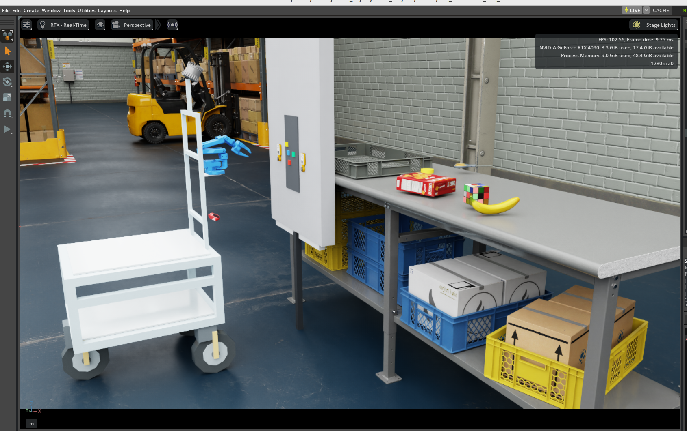

# 【PAI最終課題】Jev × Robot Agents ― 決定モデルで「人の指示」を「ロボットの動き」へ

**提出者（omnicampus アカウント名）：Ruan-roboken**

*図1：Isaac Sim 上に構築したロボットと作業環境。*

## 1. 課題の概要と目的

本課題では、Isaac Sim 上のロボットを対象に、自然言語の依頼を解釈し、タスクの計画と実行につなげる Mission Agent を構築した。目的は、Decision Model（Jev）をロボットのタスク計画や実行判断に組み込み、ロボットが持つ能力と観測結果に基づいて処理を進める仕組みを作ることである。

Mission Agent の下には、観測・物体探索を担当する Perception Agent、腕の操作を担当する ARM Agent、移動・到達確認を担当する Navigation Agent を配置した。Mission Agent が依頼全体の順序と依存関係を管理し、各 Agent が担当タスクを具体的な Robot Skill に展開する。実行は共通の仕組みで管理し、ROS 2 を通じてシミュレーション環境に接続する。

今回は特に、移動と Perception を支える基礎部分の構築に力を入れた。全体としては、将来より高度な判断を行う上位 Agent と接続できる、ロボットシステムの基盤となるフレームワークを目指している。

## 2. 工夫した点

まず、Decision Model に与える質問を、依頼の解釈、計画の確認、実行結果や問題への対応という段階ごとに設計した。それぞれの段階で必要な情報と選択肢を整理し、判断結果を実際の処理分岐に結び付けた。モデルの判断を採用する際にも、引数や実行条件の検証はコード側で行う構成とした。

次に、Mission、各領域 Agent、Robot Skill の責任範囲を整理した。Mission は「何を、どの順番で達成するか」、領域 Agent は「担当する目的をどう実現するか」、Robot Skill は「具体的な動作とその結果」を扱う。実行できない場合や問題が起きた場合に、どの情報を上位へ返すかも定義した。

また、動作が終わったことと、ユーザーの目的を達成したことを区別した。たとえば、目的地に到達しても、必要な対象確認ができていなければ、その未達を残す。判断や実行結果はログで追跡できるようにし、問題が起きた箇所を振り返りやすくした。

## 3. 苦労した点

**シミュレーション環境とロボットの基盤構築**に多くの時間を要した。ロボットを配置するだけでは十分ではなく、センサーを追加し、観測データを制御や認識に利用できる状態まで整える必要があった。カメラや LiDAR などの設定、座標系、ROS 2 との接続を調整する作業があり、上位の Agent を検討する前の基盤づくり自体が大きな課題だった。

**Decision Model をどこで、どのように役立てるか**も難しかった。初期版は設計が十分に整理されておらず、モデルを組み込むだけではタスク計画への貢献が明確にならなかった。そこで、モデルの能力とロボット側で実行できる処理を踏まえ、各段階で何を質問し、その回答をどう利用するかを見直した。この質問設計に、試行錯誤と時間を費やした。

さらに、**各 Agent と Robot Skill の境界を定義すること**にも苦労した。どこまでを一つの Skill に含めるか、どの Agent が問題を判断するか、失敗時に何を報告すれば上位が次の行動を決められるかを整理する必要があった。単に機能を分割するだけでなく、依頼・結果・失敗理由の受け渡しまで揃えることが、全体を安定して動かすうえで重要だった。

## 4. 考察と今後の課題

今回の取り組みを通じて、Decision Model を活用するには、質問の内容だけでなく、判断に必要な情報、実行可能な選択肢、完了を確認する方法を一緒に設計することが重要だと考えた。特に、各タスクをどこまで達成できるかは、実際の動作を担う Robot Skill の実装の充実度に大きく左右される。上位の判断能力を活かすためにも、下位の領域 Agent と Robot Skill 層を継続的に整備する必要がある。

アームについては、現状は基本的な姿勢（Pose）制御と、追加学習なしで利用できる既存の学習済み VLM の活用を中心としている。対象環境や作業に合わせた本格的なローカル学習・最適化にはまだ十分に取り組めておらず、今後の課題である。これまで重点的に整備してきた移動・Perception の基盤を活かし、操作能力も段階的に充実させたい。

もう一つの方向は、この下位 Agent 群を、GPT や Claude などの大規模モデルを用いた上位 Agent に接続することである。上位 Agent が長期的な目標や作業計画を扱い、下位 Agent が実行と結果の報告を担う構成へ発展させたい。

長期運用では、走行・観測・アーム作業を通じて、認識が難しかった場面、頻繁に通る経路、操作の成功・失敗例などを蓄積できると考えている。これらを学習・評価用データとして活用し、開発時には気付かなかった問題や Robot Skill の未整備部分を発見して、修正・検証を重ねていきたい。本課題は、そのように運用経験を次の改善につなげ、より賢いロボットシステムへ発展させるための基盤づくりと位置付けている。

## 5. ソースコード・デモ動画

- **GitHub：** [PAI-Final-Task](https://github.com/RXY-iit/PAI-Final-Task)
- **YouTube：** [デモ動画](https://youtu.be/nzxmE9JNy0M)

GitHub には、実際に使用しているワークスペースの一部と、日本語の README・設計資料をまとめている。各 Agent の実装、設定、ログの生成箇所は README から参照できる。
